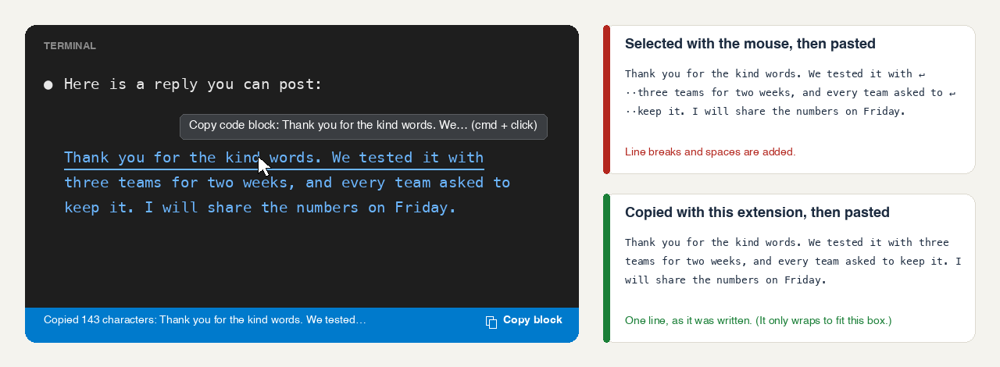

# Copy Blocks for Claude Code

Copy a code block from Claude Code's reply in the VS Code terminal exactly as it was written, with no added line breaks.



*The picture is a drawing of what happens, not a screenshot.*

## The problem

Claude Code runs in VS Code's terminal. The terminal splits a long line over several rows on the screen, and Claude Code adds spaces at the start of each row.

When you select a code block with the mouse and paste it, every screen row comes out as its own line, with spaces in front. You then have to fix the message, prompt or long command by hand.

## What this extension adds

**1. Click the block.** In the terminal, hold **Cmd** (macOS) or **Ctrl** (Windows and Linux) and point at a code block. The row is underlined, and a small tip appears that begins with "Copy code block". Click. The text inside the block is on your clipboard, as Claude wrote it.

**2. A "Copy block" button** in the status bar, the strip at the bottom of the VS Code window. One click copies the newest code block. If the newest reply has several code blocks, a list opens and you pick one. The list also holds earlier blocks, 30 at most. The button looks first at sessions started in the folder that is open in this window, and at sessions from any folder if there are none.

**3. Two commands** in the command palette (Cmd+Shift+P or Ctrl+Shift+P):

- **Copy Blocks for Claude Code: Copy newest code block**

- **Copy Blocks for Claude Code: Copy a code block from a list**

After each copy, a line at the bottom of the window says how many characters were copied and shows the first words.

It works with your recent Claude Code sessions, in any folder. You do not change anything in Claude Code.

## Install

In VS Code, open the Extensions view, search for **Copy Blocks for Claude Code**, and click **Install**. Or run:

```
code --install-extension vivmagarwal.copy-blocks-for-claude-code
```

The **Copy block** button appears at the bottom right of the window.

## What you need

- VS Code 1.80 or newer.

- Claude Code, started with the `claude` command in VS Code's terminal.

Made and tested on macOS, with VS Code 1.144 and Claude Code 2.1. It has not been tested on Windows or Linux yet. If you try it there, please tell me how it went (see "Problems and ideas").

## How it works

1. **Claude Code saves every session in a file** on your computer, in the folder `.claude/projects` in your home folder. Each reply is saved there exactly as Claude wrote it.

2. **The extension reads code blocks from those files, never from the screen.** That is why the text has no line breaks from the terminal.

3. **When you point at a row in the terminal,** the extension searches the saved code blocks for the text of that row. If a block contains it, the row becomes a link to that block.

4. **Which files it reads:** the 8 session files that changed most recently, if they changed in the last 7 days. If a file is very large, it reads only the newest 32 MB (megabytes). It reads each file once, then reads only the new lines added later. Of each session it keeps the newest 400 code blocks.

5. **It reads nothing until you use it:** the first time you point at a terminal row or click the button.

## Your data

- The extension reads Claude Code's session files on your computer. Those files hold your conversations with Claude.

- It sends nothing anywhere. It has no network code and collects no usage data.

- The only thing it changes is your clipboard, at the moment you click.

- The code is short and open: `extension.js` and `lib.js` in the [source repository](https://github.com/vivmagarwal/copy-blocks-for-claude-code).

## Limits

- **The reply must be complete.** Claude Code saves a reply only when it is finished. While Claude is still writing, the block cannot be copied yet.

- **Code blocks only.** Quotes and ordinary text do not become links.

- **Very short rows.** A row such as a single `}` can be part of several blocks. The extension then takes the newest block that has it. The tip shows the first words of the block before you click, so you can check it. A longer row is safer.

- **Old sessions.** A session that has not been used for 7 days is not searched. In a very long session, only the newest 400 code blocks can be copied.

- **Claude Code's fullscreen mode.** In that mode Claude Code handles mouse clicks itself, so a click on a block may not reach VS Code. This has not been tested. The **Copy block** button does not depend on the mouse in the terminal.

- **Remote windows** (SSH, WSL, dev containers) have not been tested.

- **A future Claude Code version may save sessions in another way.** The session files are Claude Code's own format. If the extension stops finding blocks after a Claude Code update, please report it.

- **Another settings folder.** If you run Claude Code with `CLAUDE_CONFIG_DIR` set, start VS Code with the same variable set, and the extension reads sessions from that folder.

## If something does not work

- **No "Copy block" button.** Open the command palette, run **Developer: Show Running Extensions**, and look for "Copy Blocks for Claude Code". If it is not in the list, reload the window.

- **No underline when you point at a block.** The extension did not find that row in a saved reply. Check that the reply has finished and that the text is a code block. Then use the **Copy block** button.

- **A click does nothing.** VS Code shows the key to hold in the tip on the link. It is Cmd or Ctrl unless you changed that in your VS Code settings.

- **"No code block found in the Claude Code sessions used in the last 7 days."** No saved reply has a code block, or Claude Code keeps its files in another folder (see "Another settings folder" above).

## Why a click and not a copy icon on each block?

VS Code does not let an extension draw anything on top of terminal text. An extension may turn terminal text into a link and may add a button to the status bar. This extension makes links and adds a status bar button.

## Not an Anthropic product

Vivek M Agarwal made this extension. Anthropic did not make it and does not endorse or support it. "Claude" and "Claude Code" are Anthropic's names for its own products.

## Problems and ideas

Please open an issue: <https://github.com/vivmagarwal/copy-blocks-for-claude-code/issues>

## Licence

MIT. See [LICENSE](LICENSE).
